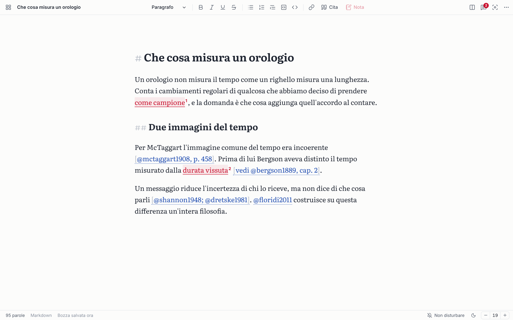
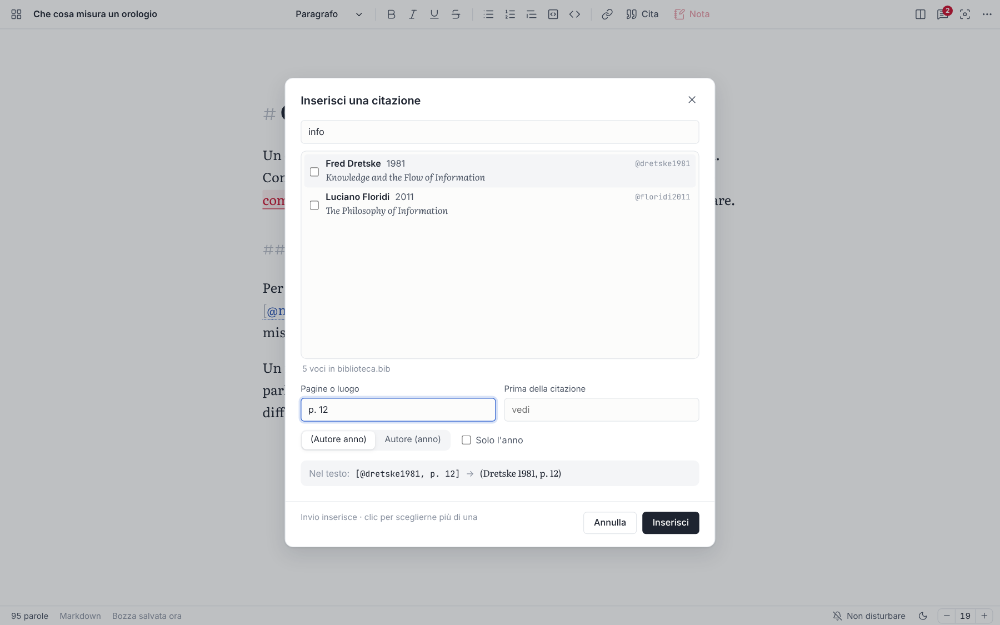
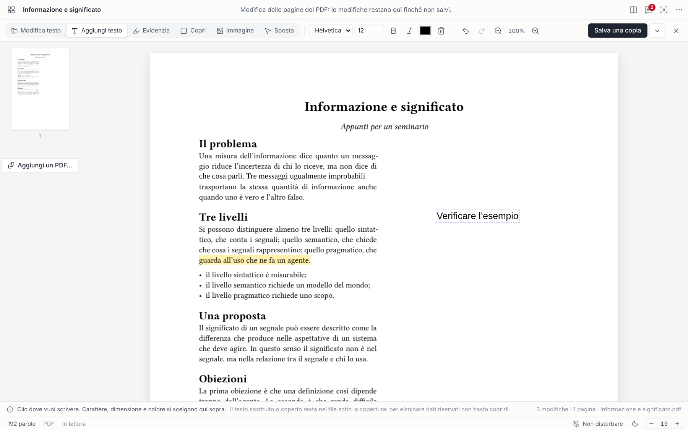

<p align="center"></p>

# Wrambi

[Read in English](README.md)

Applicazione desktop per Windows, macOS e Linux per scrivere concentrati, leggere, citare e annotare documenti. Unisce un editor senza distrazioni, una biblioteca che indicizza una cartella senza toccarne i file, note in rosso collegate al testo, citazioni da Zotero, un editor di PDF che conserva l'impaginazione e un vault cifrato da portare su un altro computer. Funziona offline, senza account. Interfaccia in italiano, inglese e francese.

Versione 0.2.0, open source con licenza [MIT](LICENSE). Tecnologia: [Tauri 2](https://tauri.app) (nucleo in Rust, interfaccia web in Svelte 5 e CodeMirror 6), compilatore [Typst](https://typst.app) integrato per i PDF, [pdf.js](https://mozilla.github.io/pdf.js/) per leggerli e [pdf-lib](https://pdf-lib.js.org) per modificarli.



---

## Avvio rapido

### Installare una versione pubblicata

Dalla pagina [Releases](../../releases) del progetto su GitHub:

| Sistema | File | Primo avvio |
| --- | --- | --- |
| Windows 10/11 | `Wrambi_x.y.z_x64-setup.exe` | Si installa per l'utente corrente, senza privilegi di amministratore. SmartScreen: «Ulteriori informazioni» → «Esegui comunque». |
| macOS 11 o successivo (Apple Silicon e Intel) | `Wrambi_x.y.z_universal.dmg` | Trascina Wrambi in Applicazioni. L'app è firmata «ad hoc», non autenticata da Apple: la prima volta, tasto destro su Wrambi → Apri → Apri. Se macOS dice che è danneggiata: `xattr -cr /Applications/Wrambi.app` nel Terminale. |
| Linux (x64) | `wrambi_x.y.z_amd64.deb` oppure `Wrambi_x.y.z_amd64.AppImage` | Installa il `.deb` (Debian, Ubuntu, Mint…) oppure rendi eseguibile l'AppImage e avviala. Serve WebKitGTK 4.1. |

Gli installer di tutti e tre i sistemi li produce GitHub: quando si pubblica un tag `v…` (per esempio `v0.2.0`), il flusso `.github/workflows/release.yml` compila Wrambi su macchine Windows, macOS e Linux e allega gli installer a una release in bozza, da controllare e pubblicare a mano. Per questo **il Mac non serve**: lo compila GitHub.

### Compilare su Windows

| Cosa | Dove | Note |
| --- | --- | --- |
| Node.js 20 o successivo | https://nodejs.org (versione LTS) | |
| Rust 1.92 o successivo, toolchain MSVC | https://rustup.rs | Lo script aggiorna Rust se è troppo vecchio |
| Strumenti di compilazione di Visual Studio 2022, con l'SDK di Windows | https://visualstudio.microsoft.com/visual-cpp-build-tools/ → «Sviluppo di applicazioni desktop con C++» | Gratuiti. Se mancano, lo script se ne accorge e propone di installarli con winget |
| WebView2 | Già presente in Windows 10 e 11 | |

Doppio clic su **`Compila Wrambi.cmd`**. È un normale script del Prompt dei comandi: non usa PowerShell. Lo script:

1. controlla i prerequisiti: aggiorna Rust se è troppo vecchio e, se mancano gli strumenti C++ o l'SDK di Windows, propone di installarli (risposta S/N);
2. installa le dipendenze JavaScript (la prima volta e dopo ogni aggiornamento che le cambia);
3. esegue i test dell'interfaccia;
4. compila la versione finale e mette nella cartella `installer\`:
   - `Wrambi_0.2.0_x64-setup.exe`: programma di installazione (per l'utente corrente, senza privilegi di amministratore; in italiano, inglese o francese secondo la lingua di Windows);
   - `Wrambi-portatile.exe`: lo stesso programma, avviabile senza installare.

La prima compilazione richiede 10–25 minuti (Rust compila Typst e Tauri) e una connessione a Internet: scarica le dipendenze e NSIS, lo strumento che crea l'installer. Le successive richiedono pochi minuti. Wrambi, una volta installato, funziona offline. Dal Prompt dei comandi, nella cartella del progetto: `"Compila Wrambi.cmd" rapido` salta i test; `"Compila Wrambi.cmd" completo` esegue anche i test del nucleo Rust.

### Compilare su macOS o Linux

- **macOS:** strumenti da riga di comando di Xcode (`xcode-select --install`), Node.js e Rust.
- **Linux (Debian/Ubuntu):** `sudo apt install libwebkit2gtk-4.1-dev libappindicator3-dev librsvg2-dev patchelf build-essential`, poi Node.js e Rust.

Poi, nella cartella del progetto: `npm install` e `npm run app:build`.

### Sviluppo

Doppio clic su **`Avvia Wrambi (sviluppo).cmd`** (Windows): apre l'app e la ricarica a ogni modifica dell'interfaccia.

Comandi equivalenti, nella cartella del progetto (su Windows prima, una volta per finestra: `set CARGO_TARGET_DIR=%LOCALAPPDATA%\Wrambi-build\target`):

```bat
npm install            # dipendenze JavaScript
npm run app            # avvia in sviluppo (tauri dev)
npm run app:build      # compila la versione finale (tauri build)
npm test               # test dell'interfaccia (Vitest)
npm run test:rust      # test del nucleo (cargo test)
npm run check          # controllo dei tipi (svelte-check)
npm run dev            # solo l'interfaccia nel browser, con dati simulati
```

### Se qualcosa va storto

- **PowerShell si chiude con `AccessViolationException` in `AmsiScanBuffer`.** È un guasto di Windows, non di Wrambi: PowerShell passa ogni script al componente antimalware (AMSI) e quel componente va in errore. Di solito dipende da un antivirus, o dai resti di uno disinstallato. Gli script di Wrambi non usano PowerShell, quindi non ne sono toccati. Per sistemare PowerShell: aggiorna o ripara l'antivirus installato, oppure, se ne hai disinstallato uno, usa il suo strumento ufficiale di rimozione completa, poi riavvia.
- **«link.exe not found»:** mancano gli strumenti C++ di Visual Studio o l'SDK di Windows. Lo script lo rileva prima di compilare e propone di installarli; a mano: scarica gli Strumenti di compilazione da https://visualstudio.microsoft.com/visual-cpp-build-tools/, spunta «Sviluppo di applicazioni desktop con C++», installa e rilancia.
- **Errore durante «npm install» o il download di NSIS:** serve Internet solo per la compilazione; riprova con la connessione attiva.
- **Qualunque altro errore:** lo script si ferma e lascia la finestra aperta; le righe che contano sono quelle con `error`.

### Cartelle e OneDrive

Il progetto sta in `OneDrive\Documenti\Wrambi`. Gli script spostano i file di compilazione di Rust (diversi GB) in `%LOCALAPPDATA%\Wrambi-build`, fuori da OneDrive. La cartella `node_modules` (circa 260 MB) resta invece nel progetto: se OneDrive la sincronizza lentamente, puoi sospendere la sincronizzazione durante la prima installazione.

---

## Cosa fa

### Lingua

- **Interfaccia in italiano, inglese e francese.** Al primo avvio Wrambi usa la lingua del sistema (se è una delle tre) e la propone in cima alla schermata di benvenuto; si cambia quando vuoi in Impostazioni → Lingua, e cambia subito, senza riavviare. Sono tradotti anche i messaggi del nucleo (errori sui file, sul vault, su Typst), la barra di ricerca dell'editor e le date.
- **Lingua dei documenti**, separata da quella dell'interfaccia (italiano, inglese, francese, tedesco, spagnolo, portoghese): guida il controllo ortografico, la sillabazione dei PDF composti da Typst, la lingua dichiarata in HTML, EPUB e LaTeX (`babel`) e i termini di bibliografie e note («Bibliografia», «a cura di», «s.d.», «Note»).
- **Scorciatoie del sistema:** su Mac i tasti si mostrano come `⌘`, `⌥`, `⇧` e funzionano con `⌘`.

### Scrittura

- **L'editor è la finestra.** Si apre su una pagina ampia, centrata, quasi a tutta finestra; barra del titolo e barra di stato sono sottili e dello stesso colore della pagina.
- **Barra di formattazione** in alto: stile del paragrafo (Paragrafo, Titolo 1–4), grassetto, corsivo, sottolineato, barrato, elenco puntato e numerato, citazione, blocco di codice, codice nel testo, collegamento, **Cita**, nota. Ogni pulsante mostra la scorciatoia; l'elenco completo è in `Ctrl+/`.
- **La struttura resta nel file.** Il formato di lavoro è Markdown: la barra scrive la sintassi (`#`, `**`, `>`…), che resta visibile ma attenuata, mentre titoli, enfasi e citazioni sono già resi a schermo. Il sottolineato, che Markdown non prevede, si scrive `<u>…</u>`. Ogni conversione parte da questa struttura.
- **Salvataggio automatico** 0,9 secondi dopo l'ultima modifica e alla chiusura. I file sul disco sono scritti in modo atomico (prima una copia temporanea, poi la sostituzione), quindi un'interruzione non lascia mai un file a metà. Se il file è stato modificato da un altro programma, Wrambi non sovrascrive: chiede se ricaricare, sovrascrivere o salvare con un altro nome.
- **Bozze.** Un nuovo documento è una bozza conservata nei dati di Wrambi finché non lo salvi come file (`Ctrl+S`, che chiede nome, formato e cartella). Creato da una cartella della Biblioteca, propone di salvarlo lì.
- **Salva una copia** (`Ctrl+Shift+S`): crea `nome_modificato.ext` accanto al file e da lì si continua sulla copia; le note del documento vengono copiate anche sulla copia.
- **Formati modificabili:** Markdown (`.md`), testo (`.txt`), LaTeX (`.tex`), Typst (`.typ`), sorgente HTML. I file in codifica Windows-1252 o UTF-16 si aprono correttamente e vengono salvati in UTF-8 (Wrambi lo segnala).
- **Temi «Carta» e «Notte»,** progettati separatamente, più «Come il sistema». Il rosso è riservato alle note.
- **Caratteri.** Quelli del sistema sono disegnati per lo schermo e sono i più nitidi: su Windows Cambria (predefinito), Georgia, Constantia, Palatino Linotype, Segoe UI, Consolas; su macOS Charter (predefinito), Iowan Old Style, Georgia, Palatino, San Francisco, Menlo; su Linux Noto Serif, DejaVu Serif, Georgia, Noto Sans, DejaVu Sans Mono. Inclusi nell'app: Literata, Source Serif, IBM Plex Sans, Atkinson Hyperlegible, JetBrains Mono. Dimensione regolabile dalla barra di stato (− 19 +), con `Ctrl+=` / `Ctrl+-` o nelle Impostazioni; anche interlinea e larghezza della pagina.
- **Focus** (`Ctrl+Shift+F`): chiude i pannelli, ritira barra e stato (riappaiono passando il mouse in alto o in basso) e attenua i paragrafi diversi da quello in cui scrivi. `Esc` per uscire.
- **Una finestra come le altre.** Per impostazione predefinita Wrambi usa la barra del titolo del sistema: si riduce a icona, si ingrandisce, si affianca e si ridimensiona come ogni programma. Su Windows e Linux, nelle Impostazioni si può scegliere la barra «Integrata», più sottile; su Mac la finestra usa sempre i pulsanti del sistema, a sinistra.
- **Schermo intero** solo quando lo scegli: `F11` (su Mac `⌃⌘F`); si esce con lo stesso tasto, `Esc` o il pulsante «Esci dallo schermo intero».
- **Non disturbare** (`Ctrl+Shift+D` o dalla barra di stato): vedi sotto.
- Cerca e sostituisci (`Ctrl+F`), controllo ortografico del sistema nella lingua dei documenti, modalità macchina da scrivere opzionale.

### Citazioni e bibliografia



- **La bibliografia:** in Impostazioni → Citazioni e bibliografia si sceglie un file `.bib` (BibTeX o BibLaTeX) o CSL JSON. Wrambi lo rilegge da solo quando cambia (al ritorno sulla finestra, all'anteprima, all'esportazione).
- **Da Zotero:** installa il componente aggiuntivo gratuito **Better BibTeX**, poi tasto destro sulla raccolta → Esporta raccolta… → formato «Better BibLaTeX» con «Mantieni aggiornato»: da quel momento Zotero aggiorna il file e Wrambi lo segue. Senza Better BibTeX va bene anche l'esportazione «BibLaTeX» o «CSL JSON» di Zotero, da ripetere quando aggiungi opere. Funzionano anche i `.bib` di JabRef, Mendeley e simili; accenti LaTeX (`{\'e}`), macro `@string`, mesi, nomi con particelle («van Beethoven») ed enti (`{World Health Organization}`) sono interpretati.
- **Citare:** «Cita» nella barra o `Ctrl+Shift+C` apre la ricerca nella bibliografia (per autore, anno, titolo o chiave). Si scelgono una o più opere, le pagine («p. 33») e cosa scrivere prima («vedi»), e la forma: «(Autore anno)» o «Autore (anno)», oppure solo l'anno. Una riga mostra il risultato prima di inserirlo.
- **Nel testo** la citazione resta nella sintassi di Pandoc, quindi il file resta portabile: `[@rossi2020, p. 33]`, `[vedi @rossi2020; @bianchi2019]`, `[-@rossi2020]` (solo l'anno), `@rossi2020` (nel discorso: «Rossi (2020)»), `@rossi2020 [p. 33]`. Scrivendo `@` Wrambi suggerisce le chiavi; le citazioni riconosciute sono sottolineate a puntini (in rosso se la chiave non è nella bibliografia) e, passandoci sopra con il mouse, mostrano la voce completa.
- **Nelle esportazioni:**
  - **HTML, EPUB, testo e anteprima:** citazioni autore-anno in stile Chicago («(Rossi 2020, p. 33; Bianchi e Verdi 2019)», «Rossi (2020)»), con le lettere per gli anni uguali (2020a, 2020b) e, in fondo, la **Bibliografia** con le sole opere citate, ordinata per autore, titoli in corsivo, DOI come collegamento. I termini seguono la lingua dei documenti.
  - **PDF e Typst:** citazioni native di Typst (`#cite`) e `#bibliography` con lo stile Chicago author-date: le compone Typst. Il `.typ` esportato ha accanto un `.bib` con le sole opere citate.
  - **LaTeX:** `\autocite`, `\textcite` e `\printbibliography` di **biblatex** (stile authoryear, con biber), più il `.bib` accanto.
  - **Markdown:** il sorgente, con le citazioni Pandoc, pronto per `pandoc --citeproc`.

### Note collegate al testo

- Seleziona un passo e premi `Ctrl+M` (o «Nota» nella barra): il testo diventa **rosso**, con un numero in esponente come una nota a piè di pagina.
- Un clic sul testo rosso o sul numero apre la nota accanto al passo; si modifica sul posto (`Ctrl+Invio` o «Fatto»).
- **Eliminare una nota:** tasto destro sul testo rosso → «Elimina la nota»; oppure tasto destro (o il cestino che compare al passaggio del mouse) su una nota nel pannello Note o in Biblioteca → Note; oppure «Elimina» nel riquadro della nota. «Elimina tutte» toglie le note di un documento. Ogni eliminazione si può annullare dall'avviso che compare.
- **Note di documenti che non esistono più** (file cancellati o spostati, bozze eliminate): in Biblioteca → Note il documento è segnato «documento non trovato» e un pulsante le elimina tutte insieme.
- Le note funzionano nei documenti modificabili e nel testo estratto da PDF, EPUB e HTML. Nei PDF si aggiungono nella vista Testo.
- Le note seguono il testo mentre scrivi. Se il documento viene modificato fuori da Wrambi, la nota si ricolloca cercando lo stesso passo nel contesto più simile; se il passo non esiste più, resta conservata con l'avviso «testo non trovato».
- **Biblioteca → Note:** tutte le note di tutti i documenti, raggruppate per documento nell'ordine del testo, con passo annotato, testo della nota e data; ricerca. Un clic riapre il documento e porta alla nota, già aperta.
- **Pannello Note** (`Ctrl+Shift+N`) accanto al documento: le note di questo documento o di tutti, con ricerca.
- **Esportare le note** in **Markdown, testo, LaTeX, Typst o PDF**: «Esporta» nel pannello Note (le note mostrate, o quelle di un documento) e in Biblioteca → Note («Esporta tutte le note», o un documento alla volta). Il file contiene, per ogni nota, il passo annotato tra virgolette e il testo della nota, raggruppati per documento.
- **Note come note a piè di pagina:** nella finestra Esporta (e nell'anteprima) l'opzione «Includi le note di Wrambi come note a piè di pagina» mette ogni nota dove finisce il passo annotato: `\footnote` in LaTeX, `#footnote` in Typst e nel PDF, note di chiusura numerate in HTML ed EPUB, rimandi `[1]` con le note in fondo nel testo semplice, `[^1]` (note di Pandoc) in Markdown. Le note restano anche in Wrambi.

### Biblioteca

La Biblioteca (`Ctrl+Shift+L`, o il pulsante a griglia in alto a sinistra) occupa tutta la finestra: a sinistra le sezioni e le cartelle, a destra i documenti come fogli con l'anteprima. `Esc`, o il pulsante con il nome del documento in alto a destra, riporta al documento aperto.

- **La cartella.** Al primo avvio Wrambi chiede una cartella: una già esistente o una nuova «Biblioteca Wrambi» in Documenti. Indicizza Markdown, testo, HTML, LaTeX, Typst, PDF ed EPUB nella cartella e nelle sottocartelle (salta file e cartelle nascosti e `node_modules`; massimo 20.000 file). **Non sposta e non copia nulla**; rinomina un file solo quando glielo chiedi.
- **Sezioni:** Tutti i documenti, Recenti, Bozze e modifiche, Note, Non letti / In lettura / Letti, e l'albero delle cartelle con i conteggi.
- **Anteprime:** la prima pagina dei PDF, la copertina degli EPUB (o una copertina con titolo e autore), l'inizio del testo per gli altri formati.
- **Su ogni documento:** formato, numero di note (in rosso), stato di lettura, cartella e data. Clic per aprirlo; tasto destro o `⋯` per Apri, **Modifica il PDF**, **Modifica il testo** (PDF, EPUB, HTML), **Esporta…**, stato di lettura, **Rinomina** (`F2`: note, stato e recenti seguono il file) e **Mostra nella cartella**.
- **Vista a pagine o a elenco**, ordinamento per data di modifica, nome o tipo, ricerca per nome.
- **Stati Non letto, In lettura, Letto** dal menu di ogni documento, dalla barra di lettura o dalla barra di stato. Aprire un documento della biblioteca lo segna «In lettura» (disattivabile).

### Lettura di PDF, EPUB e HTML

| Formato | Come si legge | Cosa si conserva |
| --- | --- | --- |
| PDF | Vista **Pagine**: le pagine originali, nitide alla risoluzione dello schermo. Vista **Testo**: testo estratto, ricostruito in paragrafi, con l'indicatore di pagina `[p. N]` | Pagine: tutto. Testo: solo il testo; impaginazione, immagini, formule e tabelle no |
| EPUB | Testo del libro in ordine di lettura, con titoli, enfasi, elenchi e citazioni | Struttura e testo; non lo stile, le immagini e i libri con DRM |
| HTML | Testo leggibile della pagina; «Apri il sorgente HTML» per il codice | Struttura e testo; script e stili ignorati |

### Modificare un PDF conservando l'impaginazione



Nella barra di lettura di un PDF (o dal menu del documento in Biblioteca), **Modifica il PDF** apre le pagine originali con gli strumenti:

- **Modifica testo:** clic su una riga e la si riscrive. Il testo nuovo prende il posto del vecchio: la riga originale viene coperta con il colore dello sfondo (campionato dalla pagina) e il testo nuovo è scritto sopra con il carattere standard più simile (con grazie, senza grazie o monospaziato, grassetto e corsivo riconosciuti dal PDF), nella stessa dimensione e nel colore del testo originale. Se il testo nuovo è più lungo, il carattere si stringe un poco per stare nella riga. Doppio clic su una riga già modificata per correggerla.
- **Aggiungi testo:** clic dove scrivere; carattere (Times, Helvetica, Courier), dimensione, grassetto, corsivo e colore nella barra.
- **Evidenzia:** trascinando sulle righe (l'evidenziazione segue le righe toccate) o con un clic su una riga; quattro colori.
- **Copri:** un rettangolo del colore dello sfondo.
- **Immagine:** PNG o JPEG, da spostare e ridimensionare.
- **Sposta:** sceglie una modifica, la sposta (trascinando) o la toglie (`Canc`).
- **Pagine** (colonna a sinistra): ruota, sposta prima o dopo, elimina, inserisce una pagina vuota, **aggiunge in fondo le pagine di un altro PDF**.
- **Annulla e ripeti** (`Ctrl+Z`, `Ctrl+Y`) per ogni operazione; zoom.
- **Salva una copia** (`nome_modificato.pdf` accanto, che poi si apre) oppure **Sostituisci l'originale**, con la copia di sicurezza `nome (originale).pdf` accanto.

**Che cosa vuol dire, con precisione.** Un PDF non contiene paragrafi da ricomporre: è un insieme di frammenti di testo in posizioni fisse. Per questo Wrambi lavora per **righe**: una riga riscritta non sposta le righe che seguono. Il testo sostituito o coperto **non viene cancellato** dal file: resta sotto la copertura, invisibile ma estraibile da un programma; quindi coprire non basta per eliminare dati riservati (Wrambi lo ricorda in fondo alla finestra). Se riordini, elimini o aggiungi pagine, Wrambi crea un PDF nuovo con le sole pagine scelte (le pagine eliminate non restano nel file); se modifichi solo il contenuto o la rotazione, modifica il file sul posto e conserva tutto il resto (segnalibri, moduli, metadati). I caratteri usati sono quelli standard dei PDF, che coprono le lingue dell'Europa occidentale; per gli altri (ł, ő, greco, cirillico) Wrambi incorpora Liberation Sans. I PDF cifrati non si possono modificare.

### Modificare il testo di PDF, EPUB e HTML

Nella barra di lettura, **Modifica il testo** (per EPUB e HTML «Modifica») rende modificabile il testo estratto (titoli, elenchi, enfasi, come in un documento Markdown) con la barra di formattazione completa. Le modifiche si conservano da sole mentre scrivi, e le note restano al loro posto. Poi `Ctrl+S` apre **Salva le modifiche**:

- **Crea una copia modificata:** `nome_modificato.pdf` (o `.epub`, `.md`…) accanto all'originale, che resta com'è. Le note vengono copiate anche sulla copia.
- **Aggiorna l'originale:** riscrive lo stesso file, con l'opzione (attiva) di conservare prima l'originale accanto come `nome (originale).pdf`.
- **Formato:** quello originale per primo, poi Markdown, PDF, EPUB, HTML, testo, LaTeX o Typst.

Qui Wrambi modifica il *testo*: un PDF salvato in questo modo è un PDF nuovo, impaginato dal Typst integrato. Per cambiare un PDF conservandone l'aspetto si usa **Modifica il PDF**, sopra.

### Conversione ed esportazione

Il pannello **Anteprima** (`Ctrl+Shift+P`) mostra il documento convertito mentre scrivi, in HTML, PDF, Typst, LaTeX o testo, con citazioni, bibliografia e (se l'opzione è attiva) note a piè di pagina. La conversione avviene in un thread separato, quindi non rallenta la digitazione.

**Esporta** (`Ctrl+Shift+E`) salva il documento nella cartella che scegli:

| Da Markdown o testo a… | Risultato | Fedeltà |
| --- | --- | --- |
| Markdown `.md` | Il sorgente (con le note di Wrambi come note di Pandoc, se richiesto) | Completa |
| Testo `.txt` | Testo con titoli sottolineati, elenchi e rientri; citazioni autore-anno, note e bibliografia in fondo | Solo il testo: enfasi e sottolineato si perdono |
| HTML `.html` | Pagina completa con stile incorporato; note di chiusura e bibliografia | Completa |
| PDF `.pdf` | A4 impaginato dal Typst integrato, font Libertinus Serif, sillabazione nella lingua dei documenti; citazioni e bibliografia di Typst, note a piè di pagina | Struttura completa; impaginazione tipografica, non una copia dell'aspetto dell'editor |
| EPUB `.epub` | EPUB 3 ridisponibile, un capitolo per titolo principale, indice; capitoli «Note» e «Bibliografia» | Struttura e testo; nessuna impaginazione fissa |
| LaTeX `.tex` | Documento `article` completo, `babel` nella lingua dei documenti, citazioni biblatex, `\footnote`; `.bib` accanto | Completa per i costrutti supportati |
| Typst `.typ` | Documento completo, citazioni e `#footnote` native; `.bib` accanto | Completa per i costrutti supportati |

Sorgenti che Wrambi **non** converte, per non produrre risultati sbagliati: Typst `.typ` (si esporta come PDF, compilato con il Typst integrato, o come sorgente), LaTeX `.tex` (nessun motore LaTeX incluso), sorgente HTML (si esporta il sorgente; per convertirlo, aprilo in lettura).

### Non disturbare

Con «Non disturbare» attivo Wrambi trattiene i propri avvisi (salvataggi, conferme) e alla disattivazione li riassume; gli errori compaiono comunque. **Non può silenziare le notifiche del sistema o di altre applicazioni**: per quelle c'è «Non disturbare» del sistema, che le Impostazioni di Wrambi aprono con un pulsante.

### Vault cifrato

Menu `⋯` → **Vault cifrato**.

- **Crea un vault:** un unico file `.wrambi` protetto da password (almeno 8 caratteri). Contiene sempre impostazioni, stati di lettura, posizioni di lettura, tutte le note e tutte le bozze; a scelta, una copia dei documenti che hanno note e/o di tutta la biblioteca.
- **Apri un vault:** su un altro computer (anche con un altro sistema), scegli il file, la password e la cartella in cui ricreare i documenti. Note e stati si uniscono a quelli presenti; nessun file esistente viene sovrascritto.
- **Cifratura:** XChaCha20-Poly1305 con chiave a 256 bit derivata dalla password con Argon2id (64 MiB, 3 passaggi). Un file manomesso o una password sbagliata vengono rifiutati.
- **Ambito della protezione:** è cifrato il file `.wrambi`; i documenti nella biblioteca e i dati di lavoro di Wrambi restano in chiaro sul computer.
- **Senza la password il vault non si apre in alcun modo.**

### Dove sono i dati

Nella cartella dei dati dell'app: `%APPDATA%\it.wrambi.desktop\` su Windows, `~/Library/Application Support/it.wrambi.desktop/` su macOS, `~/.local/share/it.wrambi.desktop/` su Linux. Contiene `settings.json`, `library.json`, `notes.json`, `session.json`, la cartella `drafts` (bozze e testi modificabili) e la cartella `thumbs` (anteprime della Biblioteca, si possono cancellare). Ogni file JSON ha una copia `.bak` della versione precedente. Le Impostazioni mostrano il percorso esatto.

---

## Scorciatoie principali

Su Mac `Ctrl` è `⌘`.

| Tasti | Azione |
| --- | --- |
| `Ctrl+N` / `Ctrl+O` / `Ctrl+S` / `Ctrl+Shift+S` | Nuovo, Apri, Salva, Salva una copia |
| `Ctrl+Shift+E` | Esporta |
| `Ctrl+0`, `Ctrl+1` … `Ctrl+4` | Paragrafo, titoli |
| `Ctrl+B` / `Ctrl+I` / `Ctrl+U` / `Ctrl+Shift+X` | Grassetto, corsivo, sottolineato, barrato |
| `Ctrl+Shift+8` / `Ctrl+Shift+7` / `Ctrl+Shift+Q` | Elenco puntato, numerato, citazione |
| `Ctrl+Alt+C` / `Ctrl+E` / `Ctrl+K` | Blocco di codice, codice nel testo, collegamento |
| `Ctrl+M` | Nota sul testo selezionato |
| `Ctrl+Shift+C` | Cita un'opera della bibliografia |
| `Ctrl+Shift+L` / `Ctrl+Shift+N` / `Ctrl+Shift+P` | Biblioteca, Note, Anteprima |
| `Esc` / `F2` / `Ctrl+F` nella Biblioteca | Torna al documento, rinomina, cerca |
| `Ctrl+Shift+F` / `F11` (Mac: `⌃⌘F`) / `Esc` | Focus, schermo intero, esci da Focus |
| `Ctrl+Shift+D` | Non disturbare |
| `Ctrl+,` / `Ctrl+/` | Impostazioni, elenco delle scorciatoie |
| `Ctrl+Z` / `Ctrl+Y` / `Canc` in Modifica il PDF | Annulla, ripeti, togli la modifica scelta |

---

## Verifiche eseguite

- **Test dell'interfaccia (Vitest), 74 test in 7 file:** struttura del documento; conversioni HTML, LaTeX, Typst, testo ed EPUB; lettura di BibTeX/BibLaTeX (accenti, macro, nomi, enti, voci rotte) e CSL JSON; citazioni autore-anno (più opere, pagine, prefissi, solo l'anno, nel discorso, 2020a/2020b) e bibliografia nelle tre lingue; citazioni riconosciute solo con chiavi esistenti (non negli indirizzi email né nei collegamenti); note come note a piè di pagina in tutti i formati e come note di Pandoc; esportazione EPUB con capitoli «Note» e «Bibliografia»; modello dell'editor di PDF (geometria identica a pdf.js su pagine ruotate, righe ricostruite dai frammenti, spazio di una riga riscritta fino al margine della sua colonna, riconoscimento dei caratteri, salvataggio sul posto e con pagine riordinate, eliminate, vuote e da un altro PDF, caratteri fuori codifica, PDF cifrati); copertura delle traduzioni (ogni frase dell'interfaccia ha la traduzione inglese e francese, con gli stessi segnaposto); ancoraggio delle note; testo dei PDF; anteprime della Biblioteca.
- **Test del nucleo Rust (cargo test), 29 test:** compilazione Typst → PDF, compresi il documento di prova e il documento con citazioni, note e bibliografia generati dalla conversione (con la bibliografia servita dalla memoria); traduzioni dei messaggi del nucleo; vault; indicizzazione; codifiche; scrittura atomica; copie «(originale)»; rinomina; finestra dentro lo schermo.
- **Controllo dei tipi** (svelte-check) e **clippy**: nessun errore né avviso.
- **Percorsi guidati da script nel browser,** in italiano, inglese e francese: testo con citazioni e note; selettore delle citazioni; anteprima con note e bibliografia; esportazione in LaTeX con il `.bib` accanto; esportazione delle note; impostazioni; Biblioteca; modifica di un PDF (riga riscritta, evidenziazione, testo aggiunto, pagine ruotate, inserite, eliminate e aggiunte da un altro PDF, annulla e ripeti, salvataggio di una copia, controllata poi pagina per pagina).
- **App vera in esecuzione** su Linux (WebKitGTK, stesso codice, guidata da script): avvio, Biblioteca, selettore delle citazioni, modifica di un PDF con una riga riscritta e salvataggio di una copia dal dialogo di sistema; pacchetto `.deb` creato con successo.

**Su GitHub** il flusso `.github/workflows/ci.yml` esegue controllo dei tipi e test dell'interfaccia, poi test del nucleo e clippy su Windows, macOS e Linux a ogni modifica; `release.yml` crea gli installer dei tre sistemi.

---

## Limiti noti

- **Markdown visibile.** La sintassi resta nel testo (attenuata), come in iA Writer: non è un editor «WYSIWYG» che nasconde i simboli.
- **Markdown supportato:** CommonMark più barrato, tabelle e citazioni di Pandoc. Non sono supportati le note a piè di pagina scritte a mano nel sorgente (`[^1]`: si usano le note di Wrambi), le formule matematiche (`$…$`), gli elenchi di attività e le immagini incorporate.
- **Citazioni:** uno stile autore-anno (sul modello del Chicago) per HTML, EPUB e testo; nel PDF e in LaTeX lo stile lo applicano Typst e biblatex, quindi l'ordine delle lettere 2020a/2020b può differire. Niente stili CSL a scelta, per ora.
- **PDF:** l'estrazione del testo è ricostruita dalle posizioni dei caratteri, quindi colonne multiple, note a piè di pagina e formule possono uscire in un ordine imperfetto; i PDF scansionati non hanno testo (niente riconoscimento ottico); i PDF protetti da password non si aprono; le note di Wrambi non vengono scritte dentro il file PDF.
- **Modifica del PDF:** per righe, non per paragrafi; caratteri standard dei PDF (non quelli incorporati nel file); il testo coperto resta nel file (vedi sopra); PDF cifrati non modificabili.
- **EPUB:** solo testo e struttura; niente immagini, niente libri con DRM.
- **LaTeX:** nessun motore incluso, quindi niente anteprima e niente conversione dei sorgenti `.tex`.
- **Typst:** i pacchetti `@preview/…` non sono disponibili (richiederebbero Internet); i font installati nel sistema sono disponibili solo attivando l'opzione nelle Impostazioni.
- **Word (.docx):** non supportato.
- **Biblioteca:** nessun controllo continuo della cartella; l'elenco si aggiorna al ritorno su Wrambi o con il pulsante. Rinominando un file dalla Biblioteca note e stato lo seguono; se viene rinominato o spostato fuori da Wrambi, no.
- **Un documento alla volta:** niente schede o finestre multiple.
- **Installer non firmati con un certificato a pagamento:** avviso di SmartScreen su Windows, apertura con il tasto destro la prima volta su macOS.
- **macOS e Linux:** compilati e verificati automaticamente da GitHub; l'uso quotidiano è stato provato soprattutto su Windows (e l'app su Linux).

---

## Struttura del progetto

```
Wrambi/
├── Compila Wrambi.cmd              compila e crea l'installer (doppio clic, Windows)
├── Avvia Wrambi (sviluppo).cmd     avvia in sviluppo (doppio clic, Windows)
├── scripts/                        prerequisiti, risorse di pdf.js, elenco delle frasi da tradurre
├── src/                            interfaccia (Svelte 5, TypeScript)
│   ├── App.svelte                  struttura della finestra, scorciatoie, avvio
│   ├── components/                 barra, editor, note, anteprima, finestre (salva, esporta, cita, vault…)
│   ├── components/home/            la Biblioteca a tutta finestra: fogli, menu, note
│   ├── components/pdfedit/         l'editor di PDF: pagine, strumenti, miniature
│   ├── lib/biblio/                 bibliografia: BibTeX, CSL JSON, stile autore-anno
│   ├── lib/convert/                Markdown, citazioni, note a piè di pagina e conversioni
│   ├── lib/editor/                 CodeMirror: formattazione, resa, note, citazioni, tema
│   ├── lib/i18n/                   lingue dell'interfaccia (en.ts, fr.ts; l'italiano è la lingua di partenza)
│   ├── lib/notes/                  ancoraggio, menu, eliminazione ed esportazione delle note
│   ├── lib/pdfedit/                modello della modifica dei PDF (pdf-lib)
│   ├── lib/reader/                 lettura dei PDF (pdf.js) e ricostruzione del testo
│   └── styles/app.css              temi e stile di base
├── src-tauri/                      nucleo (Rust)
│   └── src/  commands.rs files.rs i18n.rs library.rs typeset.rs vault.rs window.rs
├── tests/                          test dell'interfaccia e file di prova
├── LICENSE, CONTRIBUTING.md, CHANGELOG.md
├── docs/screenshots/               immagini dei README (it/ per quello italiano)
├── .github/workflows/              verifiche e release automatiche su GitHub (Windows, macOS, Linux)
└── assets/                         logo (logo.png) e sorgente delle icone (icon.png)
```
