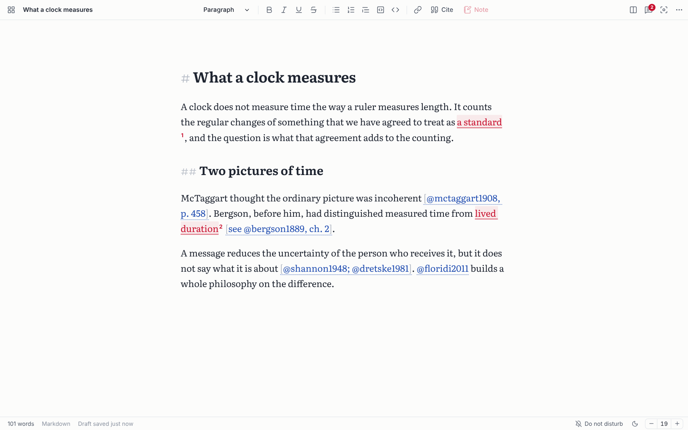
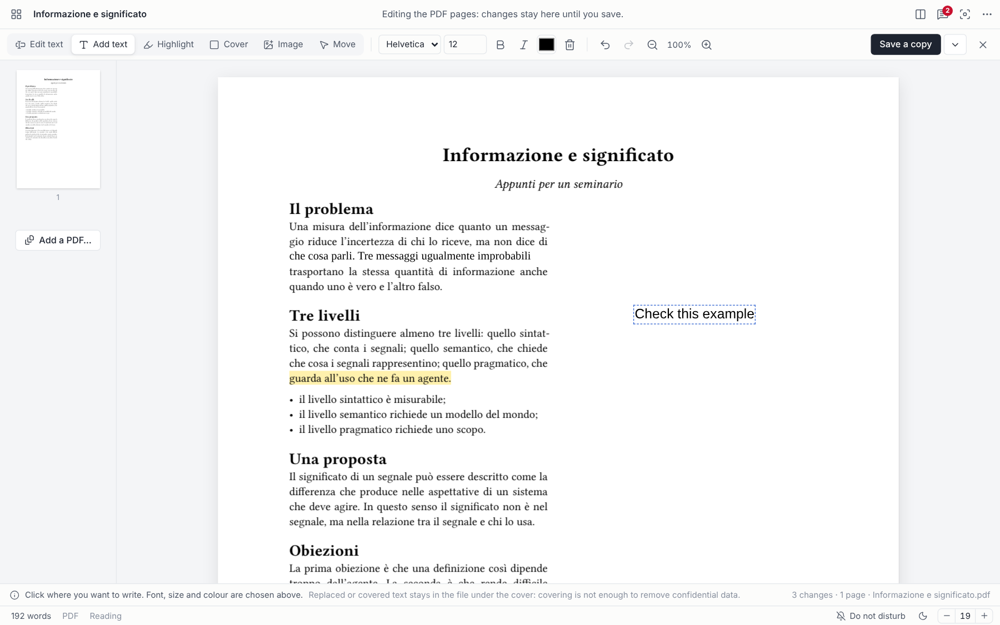
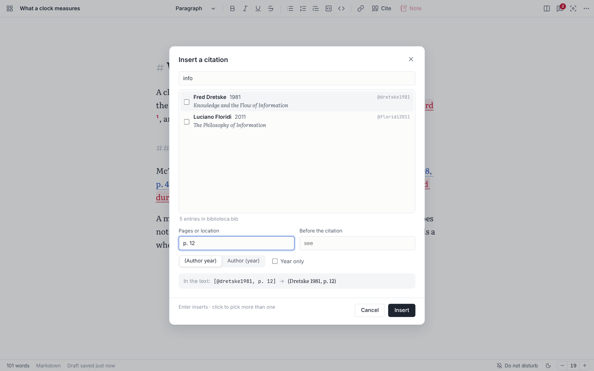
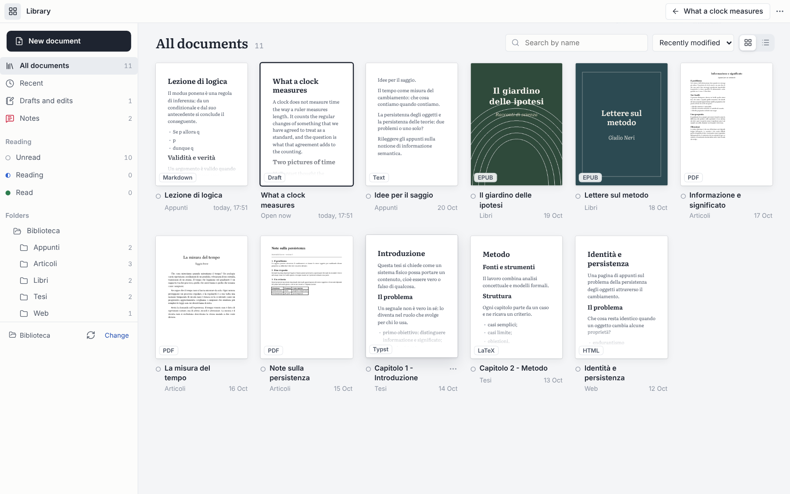
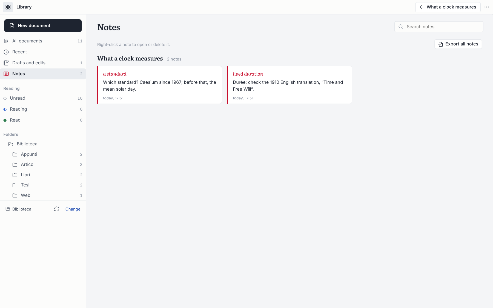
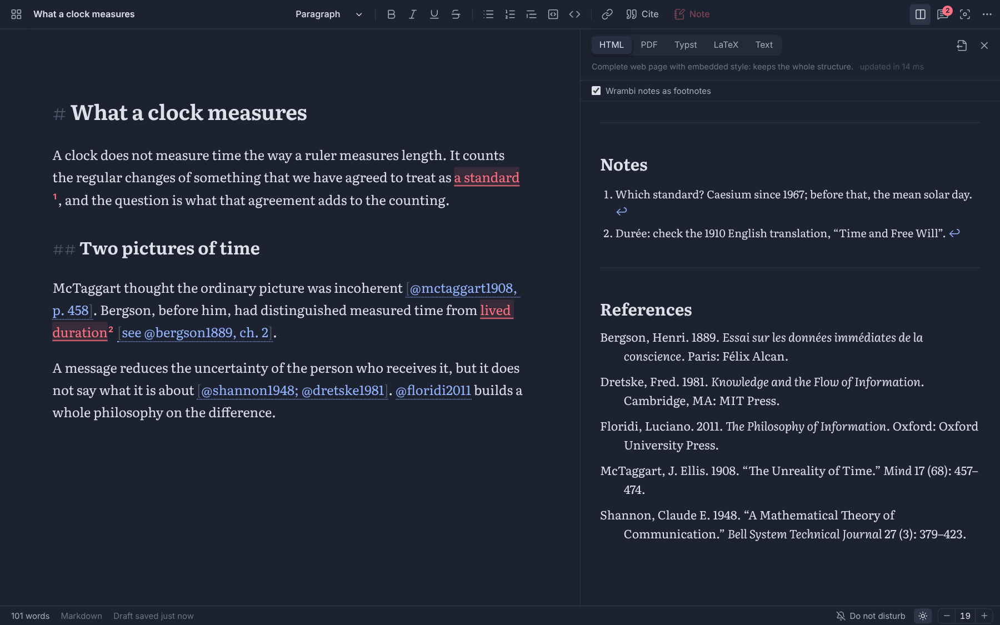
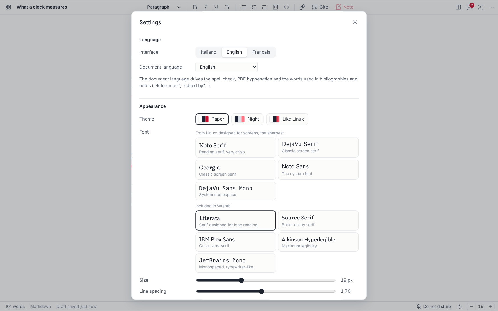

<p align="center">
  
</p>

<h1 align="center">Wrambi</h1>

<p align="center">
  <b>Write, read, annotate and cite in one calm window.</b><br/>
  A free desktop app for people who write with other people's books open.<br/>
  Offline. No account. No telemetry. Your files stay plain files.
</p>

<p align="center">
  
  
  
  
  
</p>

<p align="center">
  <a href="../../releases/latest"><b>Download</b></a>
  &nbsp;·&nbsp;
  <a href="#why-wrambi-exists">Why</a>
  &nbsp;·&nbsp;
  <a href="#a-short-tour">Tour</a>
  &nbsp;·&nbsp;
  <a href="#what-wrambi-is-not">What it is not</a>
  &nbsp;·&nbsp;
  <a href="#build-it-yourself">Build</a>
  &nbsp;·&nbsp;
  <a href="README.it.md">Italiano</a>
</p>



<p align="center"><sub>An essay in Wrambi. Blue: citations from a Zotero library. Red: my notes, attached to the exact words they are about.</sub></p>

## Why Wrambi exists

I write philosophy. If you have ever written something long that leans on other people's writing (a thesis, a paper, a book chapter, a serious essay), you know what the working day looks like. The PDF is open in one program. The notes are in a second one. Zotero is in a third. The draft is in a fourth. At least two of them want you to sign in to a cloud you never asked for, and one of them is updating.

The clutter is annoying, but it is not the real problem. The real problem is that what you think *while reading* ends up far away from what you are *writing*. The note I took on page 47 lives in a different universe from the paragraph that needs it, and every time I want it back I have to go hunting for it.

So I asked myself a small question: what is the simplest program that keeps reading, notes, citations and writing in one place, without becoming yet another "workspace" that swallows my files into its own database?

Wrambi is my answer.

- It opens **your folder**. It does not import anything, and it never moves, copies or renames a file unless you ask.
- It writes **Markdown**, which any program can open today and in thirty years.
- It pins each **note to the exact words** it is about, and the note survives when the text around it changes.
- When you are done, it hands you a **typeset PDF**, a **LaTeX** file with a real `biblatex` bibliography, an **EPUB** or a **Typst** file. You don't need to install TeX or be online, and it never asks who you are.

It is free, it is MIT licensed, and it will stay that way.

## What it does, in thirty seconds

**A writing room.** One page, one cursor, no ribbons. Markdown underneath, so your text is never trapped in a format. Autosave, Focus mode, typewriter scrolling, light and dark themes, spell checking in six languages.

**Notes on the text, not next to it.** Select a passage and press `Ctrl+M`. The words turn red and the note opens like a footnote. Every note from every document lives in one view, where you can search it and export it. When you export the document, the notes can become real footnotes.

**Citations from Zotero.** Point Wrambi at a `.bib` or CSL JSON file. Press `Ctrl+Shift+C`, type a name, pick the work, add a page. Citations and the reference list come out right in every format, and they are native citations in LaTeX and Typst. If Zotero keeps the file updated, Wrambi picks up the changes.

**A PDF editor that keeps the layout.** Click a line and rewrite it. Add text, highlight, cover, drop in an image. Rotate, reorder, delete and merge pages. Undo everything.

**A library of your own files.** Real page previews of your PDFs, EPUB covers, folders, and reading states: unread, reading, read.

**Export without installing anything.** PDF (the [Typst](https://typst.app) typesetter is built in), EPUB, HTML, LaTeX, Typst, Markdown and plain text.

**An encrypted vault.** One file, one password, to carry your notes, settings, drafts and documents to another computer with no cloud in between.

**Everywhere you write.** Windows, macOS and Linux, in English, Italian and French.

## A short tour

<table>
  <tr>
    <td width="50%"></td>
    <td width="50%"></td>
  </tr>
  <tr>
    <td><sub><b>Edit a PDF and keep its layout.</b> One line rewritten, a passage highlighted, a comment added in the margin.</sub></td>
    <td><sub><b>Cite while you write.</b> Search your Zotero library, pick one or more works, add a page or a "see".</sub></td>
  </tr>
  <tr>
    <td></td>
    <td></td>
  </tr>
  <tr>
    <td><sub><b>Your folder as a library.</b> Page previews, folders and reading states, with nothing imported.</sub></td>
    <td><sub><b>Every note in one place.</b> Grouped by document, searchable, exportable to Markdown, LaTeX, Typst or PDF.</sub></td>
  </tr>
  <tr>
    <td></td>
    <td></td>
  </tr>
  <tr>
    <td><sub><b>Live preview.</b> Your notes and the reference list, already formatted. One click switches to PDF, Typst, LaTeX or text.</sub></td>
    <td><sub><b>Make it yours.</b> Interface and document language, themes, the sharpest screen fonts of your system or five bundled ones.</sub></td>
  </tr>
</table>

## Download

Get the installer for your system from the [latest release](../../releases/latest). The installers are not yet signed with a paid certificate, so each system asks for confirmation the first time you open Wrambi.

| System | File | The first time |
| --- | --- | --- |
| Windows 10 and 11 | `Wrambi_x.y.z_x64-setup.exe` | Installs for your user, no administrator rights needed. If SmartScreen appears: *More info* → *Run anyway*. |
| macOS 11 or newer (Apple silicon and Intel) | `Wrambi_x.y.z_universal.dmg` | Drag Wrambi to Applications, then right-click it → *Open* → *Open*. If macOS says the app is damaged, run `xattr -cr /Applications/Wrambi.app` in Terminal. |
| Linux (x64) | `Wrambi_x.y.z_amd64.deb` or `Wrambi_x.y.z_amd64.AppImage` | Install the `.deb` (Debian, Ubuntu, Mint…), or make the AppImage executable and run it. Needs WebKitGTK 4.1. |

Wrambi starts in your system's language (English, Italian or French). You can change it in **Settings › Language**.

## What Wrambi is not

I'd rather you know this before you install it.

- **It is not a cloud service.** There is no account, no sync server, no analytics, and the app does not even check for updates. Wrambi makes no network requests of its own. The only exceptions: web images you link in a document load in the preview, and on Windows the installer downloads Microsoft's WebView2 if the system lacks it.
- **It is not Word.** The Markdown marks stay visible, dimmed, as in iA Writer. If you need tracked changes with a co-author, Word is the right tool.
- **It is not Acrobat.** A PDF has no paragraphs, only lines placed on a page, so a rewritten line does not push the following ones down, and the new text uses the closest standard font, not the original one. Replaced or covered text is hidden, not deleted: it is still inside the file, so covering is not a way to remove confidential data.
- **It is not a reference manager.** Zotero is very good at that. Wrambi reads what Zotero exports and formats it author-year (Chicago style) in HTML, EPUB and text. In PDF and LaTeX, Typst and biblatex apply their own author-year styles.
- **It does not read scans.** A scanned PDF has no text, and there is no OCR.
- **It opens one document at a time.** No tabs. That is mostly on purpose.

The full list of limitations is in the [Italian documentation](README.it.md).

<details>
<summary><b>Everything it does, in detail</b></summary>

**Writing**
- Markdown editor (CodeMirror 6) that shows the structure while keeping the file plain text: headings, bold, italic, underline, strikethrough, lists, quotes, code, links.
- Autosave 0.9 seconds after you stop typing, with atomic writes, so a crash never leaves half a file. If a file changed on disk, Wrambi asks before overwriting it.
- Drafts that live inside Wrambi until you save them as files.
- Focus mode, typewriter scrolling, light and dark themes, the system's screen fonts or five bundled fonts, adjustable text size and line width.
- Spell checking in the document language: Italian, English, French, German, Spanish or Portuguese.
- Also edits plain text, LaTeX (`.tex`), Typst (`.typ`) and HTML sources.

**Citations and bibliography**
- Reads BibTeX, BibLaTeX and CSL JSON. With Zotero's Better BibTeX add-on and *Keep updated*, Wrambi rereads the file when Zotero changes it.
- The text keeps Pandoc syntax (`[@rossi2020, p. 33]`, `@rossi2020`), so it stays portable. Type `@` for suggestions; hover a citation to see the full reference.
- Author-year citations with 2020a/2020b disambiguation and terms in the document language.
- Typst and LaTeX exports get a `.bib` file next to them with only the works you cited.

**Notes**
- Notes on every format. The anchor (the quoted words plus some context) survives edits made inside or outside Wrambi. A note whose text can no longer be found is flagged, never silently dropped.
- Export the notes of one document, or all of them, to Markdown, plain text, LaTeX, Typst or PDF, each with its passage.
- Notes as footnotes: `\footnote` in LaTeX, `#footnote` in Typst and PDF, endnotes in HTML and EPUB, `[^1]` in Markdown.
- Delete a note from its card, from the Notes view, or by right-clicking the red text. Every deletion can be undone.

**Library and reading**
- Sections for all documents, recent ones, drafts and edits, notes, the three reading states, and the folder tree. Grid or list, sorting, search.
- Rename a file with `F2`: its notes, reading state and history follow it.
- PDF: original pages (pdf.js), or the extracted text rebuilt as Markdown (headings, lists, paragraphs, rejoined hyphenated words).
- EPUB and HTML: readable text with headings, emphasis, lists and quotes.

**PDF editing**
- Edit text, add text, highlight, cover, insert PNG or JPEG images (movable and resizable).
- Rotate, move and delete pages, insert blank pages, append the pages of another PDF.
- Save a copy, or replace the original and keep a backup next to it.

**Export** (offline): Markdown, plain text, HTML, PDF, EPUB 3, LaTeX and Typst, each with a short note on what the format keeps and what it loses.

**Vault**: a single `.wrambi` file encrypted with XChaCha20-Poly1305 and an Argon2id key.

</details>

<details>
<summary><b>Keyboard shortcuts</b></summary>

On a Mac, `Ctrl` is `⌘`.

| Keys | Action |
| --- | --- |
| `Ctrl+N` / `Ctrl+O` / `Ctrl+S` | New, open, save |
| `Ctrl+M` | Note on the selected text |
| `Ctrl+Shift+C` | Cite a work from the bibliography |
| `Ctrl+Shift+L` / `Ctrl+Shift+N` / `Ctrl+Shift+P` | Library, notes, preview |
| `Ctrl+Shift+E` | Export |
| `Ctrl+Shift+F` / `Esc` | Focus mode, leave Focus |
| `F11` (Mac: `⌃⌘F`) | Full screen |
| `Ctrl+Shift+D` | Do not disturb |
| `Ctrl+,` / `Ctrl+/` | Settings, all shortcuts |

</details>

## How it is built

Wrambi is about 20,000 lines of TypeScript, Svelte and Rust. The shell is [Tauri 2](https://tauri.app), so Wrambi uses the web view your system already has instead of shipping its own copy of Chrome. The whole app, a complete typesetting engine included, comes in an installer of around 20 MB.

| Part | Technology |
| --- | --- |
| Shell | [Tauri 2](https://tauri.app): a Rust core and the system web view (WebView2, WKWebView, WebKitGTK) |
| Interface | [Svelte 5](https://svelte.dev), TypeScript, [CodeMirror 6](https://codemirror.net) |
| PDF reading | [pdf.js](https://mozilla.github.io/pdf.js/) |
| PDF editing | [pdf-lib](https://pdf-lib.js.org) |
| PDF writing | [Typst](https://typst.app) 0.15, embedded as a Rust library, with its Hayagriva engine for citations |
| Markdown | [markdown-it](https://github.com/markdown-it/markdown-it), with Pandoc-style citations |
| Bibliography | its own BibTeX/BibLaTeX and CSL JSON readers |
| EPUB | its own reader and writer, [fflate](https://github.com/101arrowz/fflate) for the zip |
| Vault | XChaCha20-Poly1305 and Argon2id ([RustCrypto](https://github.com/RustCrypto)) |

Every change to `main` and every pull request runs the type checker and 74 interface tests, then 29 Rust tests and clippy on Windows, macOS and Linux. Pushing a `v*` tag builds the installers for all three systems on GitHub's machines. I don't own a Mac: GitHub builds the macOS app.

```
src/                  interface (Svelte + TypeScript)
  components/         window, toolbar, editor, panels, dialogs
  components/home/    the full-window library
  components/pdfedit/ the PDF editor
  lib/biblio/         BibTeX and CSL JSON, author-year formatting
  lib/convert/        Markdown parsing, citations, footnotes, conversions
  lib/editor/         CodeMirror setup, formatting, notes, citations
  lib/i18n/           interface languages
  lib/pdfedit/        PDF editing model
  lib/reader/         PDF reading and text reconstruction
src-tauri/src/        Rust core: files, library scan, Typst, vault, window
tests/                interface tests and sample files
```

## Build it yourself

You need [Node.js](https://nodejs.org) 20+ and [Rust](https://rustup.rs) 1.92+, plus:

- **Windows:** the Visual Studio Build Tools with *Desktop development with C++*. Then just double-click `Compila Wrambi.cmd`: it checks everything (and offers to install the C++ tools with winget), runs the tests and puts the installer in `installer\`.
- **macOS:** the Xcode command line tools (`xcode-select --install`).
- **Linux (Debian/Ubuntu):** `sudo apt install libwebkit2gtk-4.1-dev libappindicator3-dev librsvg2-dev patchelf build-essential`.

```sh
npm install
npm run app          # development, with hot reload
npm run app:build    # release build and installer for this system
npm test             # interface tests
npm run test:rust    # core tests
npm run check        # type checking
```

## Your data

Your documents stay where they are. Wrambi's own data (settings, notes, reading states, drafts, previews) lives in the system's app-data folder: `%APPDATA%\it.wrambi.desktop\` on Windows, `~/Library/Application Support/it.wrambi.desktop/` on macOS, `~/.local/share/it.wrambi.desktop/` on Linux. Notes and settings are plain JSON files, each with a `.bak` copy of its previous version: you can read them, back them up, or take them with you.

## Helping

Wrambi does not phone home, so I have no idea how many people use it. **A star on this repository is the only signal I get**, and it helps other people who write with ten PDFs open find it.

If Wrambi saves you an afternoon:

- give it a ⭐, and tell a friend who is writing a thesis;
- [open an issue](../../issues) when something annoys you. A PDF that comes out wrong is a perfect bug report, if you can share it;
- translate it into your language. It is one dictionary file plus a few lines, see [CONTRIBUTING.md](CONTRIBUTING.md).

Pull requests are welcome too. Please keep the spirit: offline, no accounts, files that belong to their owner.

## License

[MIT](LICENSE) © 2026 Stefano Coelati Rama.

Wrambi includes third-party software under its own licenses: Typst and pdf.js (Apache 2.0); Tauri (MIT or Apache 2.0); Svelte, CodeMirror, markdown-it, pdf-lib and fflate (MIT); Lucide icons (ISC); the bundled fonts Literata, Source Serif 4, IBM Plex Sans, Atkinson Hyperlegible Next and JetBrains Mono, the fonts embedded by Typst, and Liberation Sans shipped with pdf.js (SIL Open Font License).

<p align="center">
  <br/>
  <sub>Made in Turin, between one chapter and the next.</sub>
</p>
